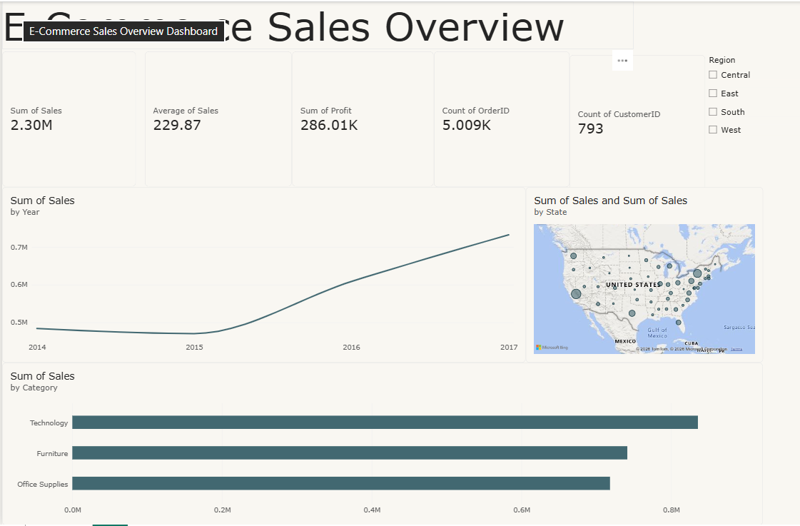

# 🛒 E-Commerce Sales & Customer Retention Analysis

An end-to-end data analytics project analyzing **9,900+ e-commerce transactions** to uncover sales trends, customer segments, and retention patterns using **Python, SQL Server, Power BI, and Excel**.



## 🎯 Business Problem

An e-commerce company needed visibility into:
- Which products, regions, and customer segments drive revenue
- Which customers are loyal vs at-risk of churning
- How well customers are retained month-over-month

## 🛠️ Tech Stack

| Stage | Tool |
|-------|------|
| Data Cleaning & EDA | Python (Pandas, NumPy, Matplotlib, Seaborn) |
| Database & Querying | SQL Server (SSMS) |
| Business Intelligence | Power BI (DAX) |
| Reporting | Excel (Pivot Tables, Slicers) |

## 🔄 Project Workflow

1. **Python** – Cleaned 9,994 rows, engineered features (Year, Month, ShipDays, ProfitMargin), performed **RFM segmentation** and **cohort retention analysis**.
2. **SQL Server** – Loaded cleaned data, wrote 8 analytical queries (KPIs, YoY growth, top customers, repeat vs one-time customers).
3. **Power BI** – Built an interactive dashboard with **7 KPI cards, 4 DAX measures**, time-series trend, geographic map, and slicer.
4. **Excel** – Built a pivot-based dashboard with slicers for stakeholder self-service.

## 📊 Key Insights

- **$2.29M total sales** across **5,009 orders** and **793 unique customers**
- **$286K total profit** with a **12.46% profit margin**
- **Technology** category leads revenue; **Furniture** has the lowest margin
- **West region** is the top performer; **Central** has the lowest margin
- **98% repeat customer rate** — strong retention
- **325 high-value customers (Champions + Loyal)** contribute ~55% of revenue
- Clear **YoY sales growth from 2014 to 2017**

## 📁 Repository Structure

```
├── data/
│   ├── raw/                # Original dataset
│   └── Cleaned/            # Cleaned + RFM segments
├── python/                 # EDA + SQL load scripts
├── sql/                    # Analysis queries
├── powerbi/                # .pbix dashboard
├── excel/                  # Excel dashboard
├── images/                 # Charts and screenshots
├── README.md
└── requirements.txt
```

## 🚀 How to Reproduce

```bash
# 1. Install dependencies
pip install -r requirements.txt

# 2. Run data cleaning & EDA
cd python
python 01_data_cleaning_eda.py

# 3. Load data into SQL Server
python 02_load_to_sql.py

# 4. Open Power BI dashboard
#    powerbi/Ecommerce_Dashboard.pbix
```

## 👤 Author

**[Aman Singh]**
- GitHub: [github.com/amansingh240902-stack](https://github.com/amansingh240902-stack)